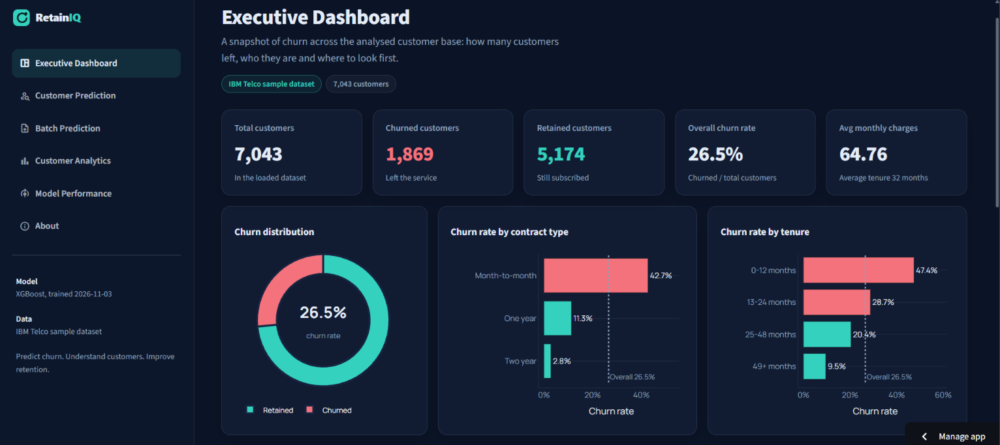
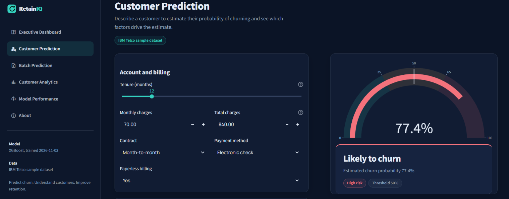
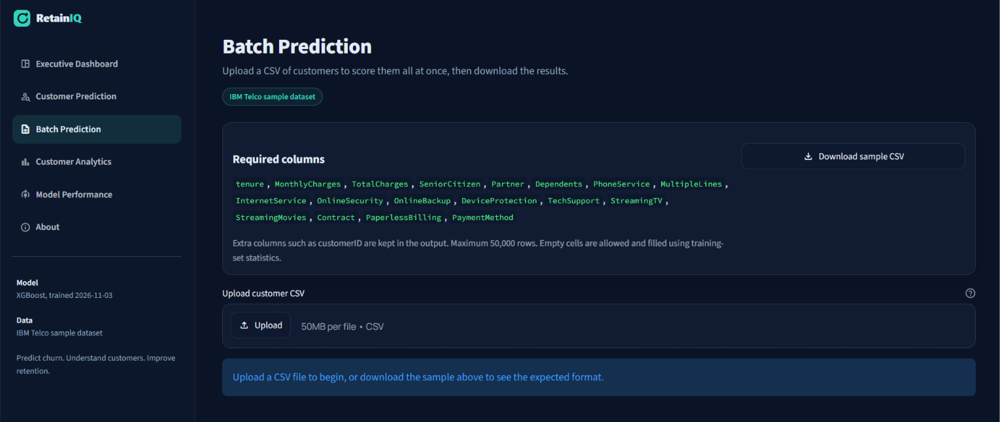
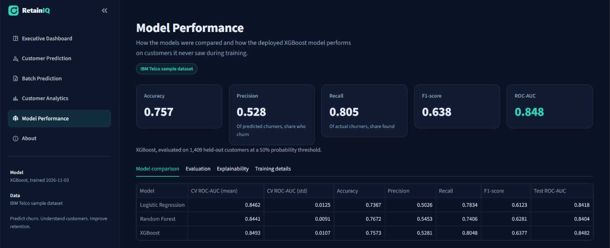

# RetainIQ — Customer Intelligence & Churn Prediction Platform

**Predict customer churn. Understand customer behaviour. Improve retention.**

RetainIQ is a machine learning-based customer intelligence platform that predicts customer churn, identifies important churn drivers, and provides interactive analytics to support data-driven customer retention decisions.

Built using Python, Scikit-learn, XGBoost, SHAP, and Streamlit, the platform provides individual customer predictions, batch predictions, customer analytics, and model performance evaluation through a multi-page dashboard.

---

## Live Application

**Live Demo:** [Open RetainIQ](https://retaiNIQ.streamlit.app/)

**GitHub Repository:** [dheerajkumar25-dev/RetainIQ](https://github.com/dheerajkumar25-dev/RetainIQ)

> The project uses the IBM Telco Customer Churn sample dataset. It is an educational and portfolio project, not a production system connected to an actual telecom company.

## Application Screenshots

### Executive Dashboard


### Customer Prediction


### Batch Prediction


### Customer Analytics


### Model Performance


---

## Key Features

- **Executive Dashboard:** Overview of customer distribution, churn rate, and key business indicators.
- **Customer Prediction:** Predict the churn probability of an individual customer.
- **Batch Prediction:** Upload customer records in CSV format and generate predictions in bulk.
- **Customer Analytics:** Explore customer segments, service usage, contracts, and churn patterns.
- **Model Performance:** Compare machine learning models using evaluation metrics.
- **Model Explainability:** Use SHAP to understand the features influencing churn predictions.

## Technology Stack

| Category | Technologies |
|---|---|
| Language | Python |
| Data Processing | Pandas, NumPy |
| Machine Learning | Scikit-learn, XGBoost |
| Explainable AI | SHAP |
| Visualization | Plotly, Matplotlib, Seaborn |
| Web Framework | Streamlit |
| Model Persistence | Joblib |
| Testing | Pytest |

## Dataset

The project uses the IBM Telco Customer Churn sample dataset.

- **Total records:** 7,043 customers
- **Features:** 21 original columns
- **Churned customers:** 1,869
- **Retained customers:** 5,174
- **Churn rate:** Approximately 26.5%

The `customerID` column is excluded from model training because it is an identifier. The `gender` column is also excluded from the model features.

The final prediction pipeline uses 18 customer features.

## Machine Learning Workflow

1. Load and inspect the customer dataset.
2. Clean and preprocess the data.
3. Prepare numerical and categorical features.
4. Split the data into training and testing sets.
5. Train and compare Logistic Regression, Random Forest, and XGBoost.
6. Evaluate models using cross-validation and test-set metrics.
7. Select XGBoost as the deployed model.
8. Apply SHAP to interpret feature contributions.
9. Save the trained pipeline using Joblib.
10. Integrate the model into the Streamlit application.

## Model Evaluation

The selected XGBoost model was evaluated on a held-out test set of 1,409 customers.

| Metric | XGBoost |
|---|---:|
| Accuracy | 75.73% |
| Precision | 52.81% |
| Recall | 80.48% |
| F1-score | 63.77% |
| Test ROC-AUC | 84.82% |
| Cross-validation ROC-AUC | 84.93% ± 1.07% |

### Model Comparison

| Model | CV ROC-AUC Mean | Test ROC-AUC |
|---|---:|---:|
| Logistic Regression | 0.8462 | 0.8418 |
| Random Forest | 0.8441 | 0.8404 |
| XGBoost | **0.8493** | **0.8482** |

XGBoost was selected because it achieved the strongest ROC-AUC performance among the compared models and provided a useful recall score for identifying customers who may churn.

## Explainability

SHAP (SHapley Additive exPlanations) is used to interpret model predictions and understand which customer attributes influence churn predictions.

Some important features identified by the model include:

- Contract type
- Tenure
- Online security
- Internet service
- Monthly charges
- Payment method
- Technical support

These insights can help explore customer segments that may need retention attention.

## Project Structure

```text
RetainIQ/
│
├── app/
│   ├── app.py
│   ├── components/
│   └── pages/
│
├── data/
│   └── raw/
│
├── docs/
│   └── images/
│
├── models/
│   └── churn_pipeline.joblib
│
├── src/
│   ├── data/
│   ├── features/
│   ├── models/
│   └── train.py
│
├── tests/
│
├── .streamlit/
├── requirements.txt
├── packages.txt
├── Dockerfile
├── .gitignore
└── README.md
```

## Run Locally

### 1. Clone the repository

```bash
git clone https://github.com/dheerajkumar25-dev/RetainIQ.git
cd RetainIQ
```

### 2. Create a virtual environment

```bash
python -m venv .venv
```

### 3. Activate the environment

**Windows PowerShell:**

```powershell
.\.venv\Scripts\Activate.ps1
```

### 4. Install dependencies

```bash
python -m pip install --upgrade pip
pip install -r requirements.txt
```

### 5. Run the application

```bash
python -m streamlit run app/app.py
```

The application will open in your browser.

## Testing

The project includes automated tests for the machine learning pipeline and Streamlit application.

Run the test suite:

```bash
python -m pytest -v
```

**Latest test result:** 73 tests passed.

## Limitations

- The model is trained on a public sample dataset, not live telecom customer data.
- Predictions represent model estimates and should not be treated as guaranteed customer behaviour.
- Model performance may change when applied to a different customer population.
- The project is intended for demonstration, learning, and portfolio purposes.

## Future Improvements

- Integrate real-time customer data.
- Add model monitoring and drift detection.
- Experiment with additional machine learning algorithms.
- Improve customer segmentation and retention recommendations.
- Add periodic model retraining.

## Author

**Dheeraj Kumar**  
B.Tech — Electronics and Communication Engineering  
Indian Institute of Information Technology, Bhagalpur

- GitHub: [dheerajkumar25-dev](https://github.com/dheerajkumar25-dev)
- Project: [RetainIQ](https://github.com/dheerajkumar25-dev/RetainIQ)

---

*Built as a machine learning and customer analytics portfolio project.*